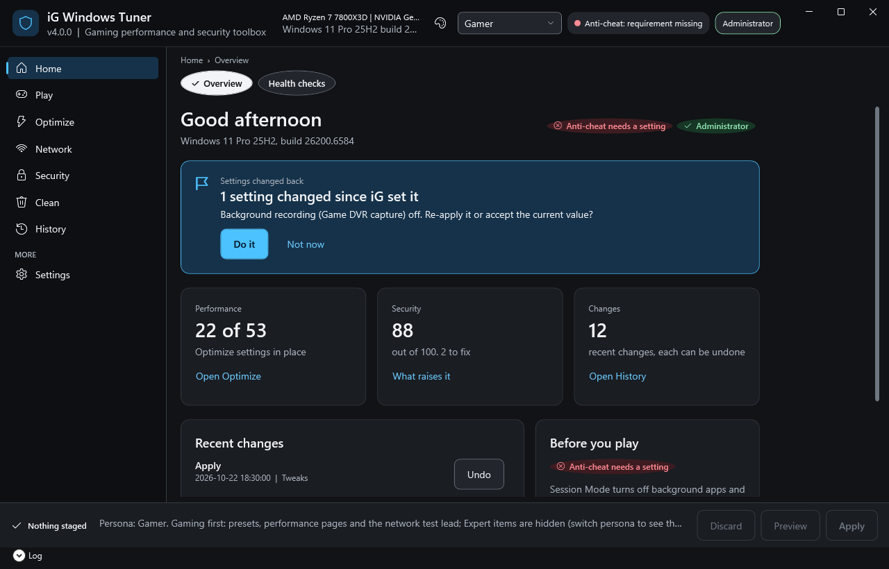
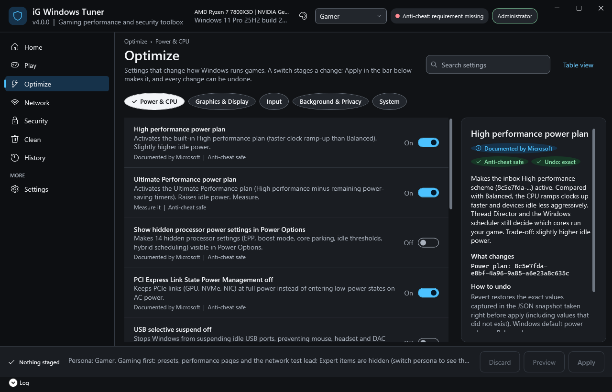
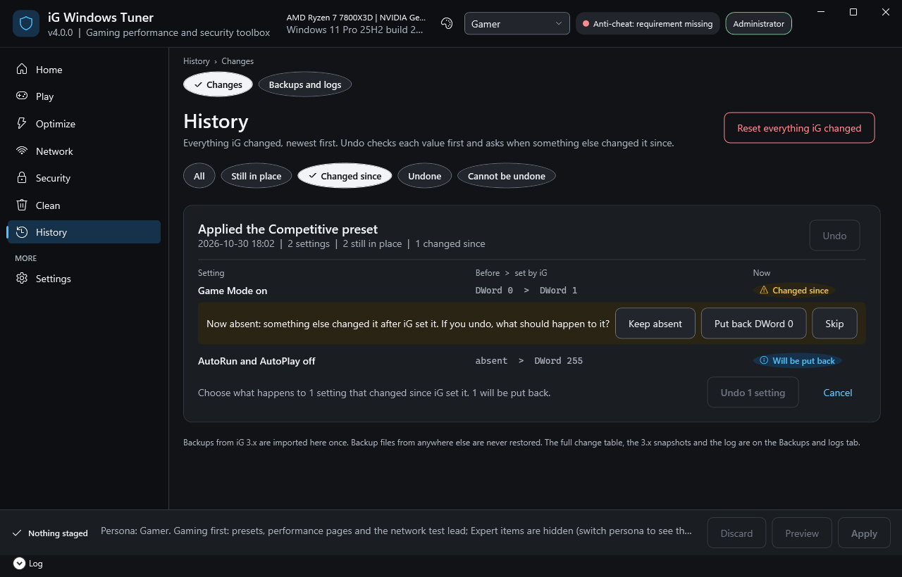
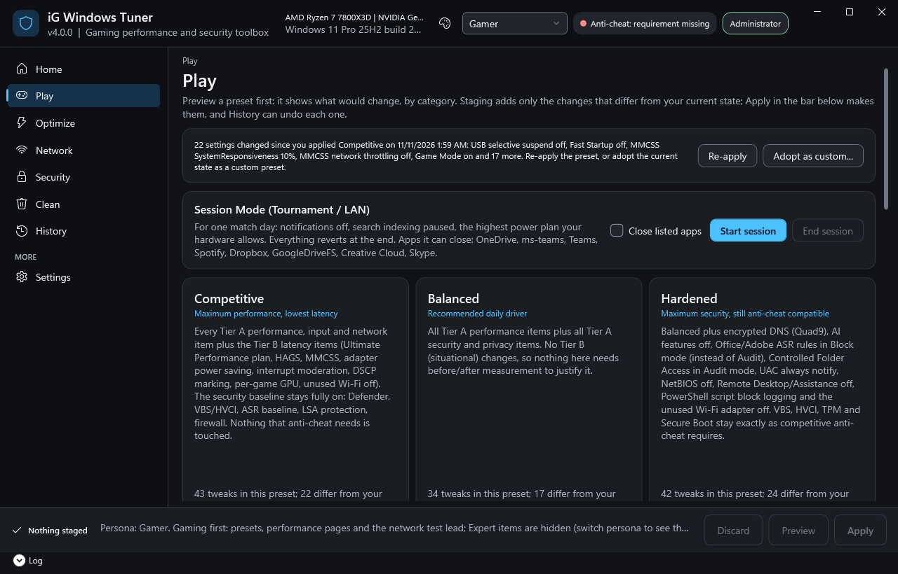
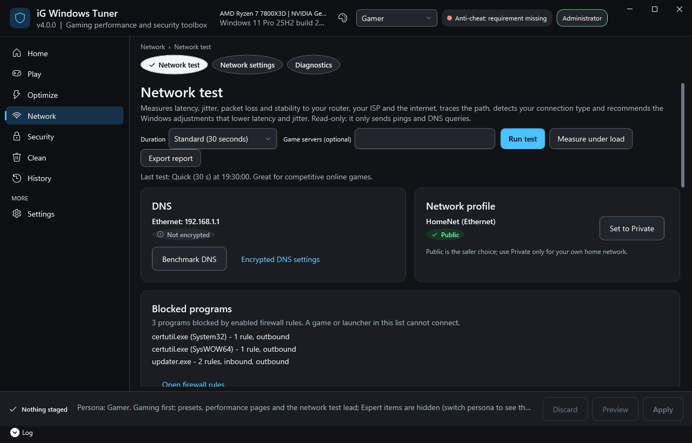
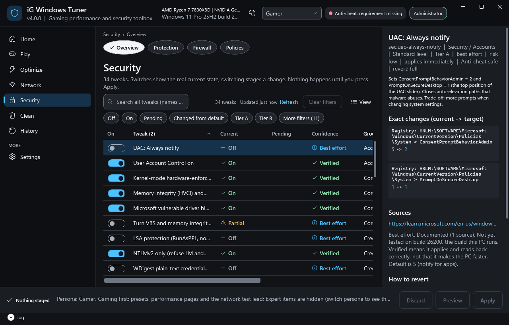
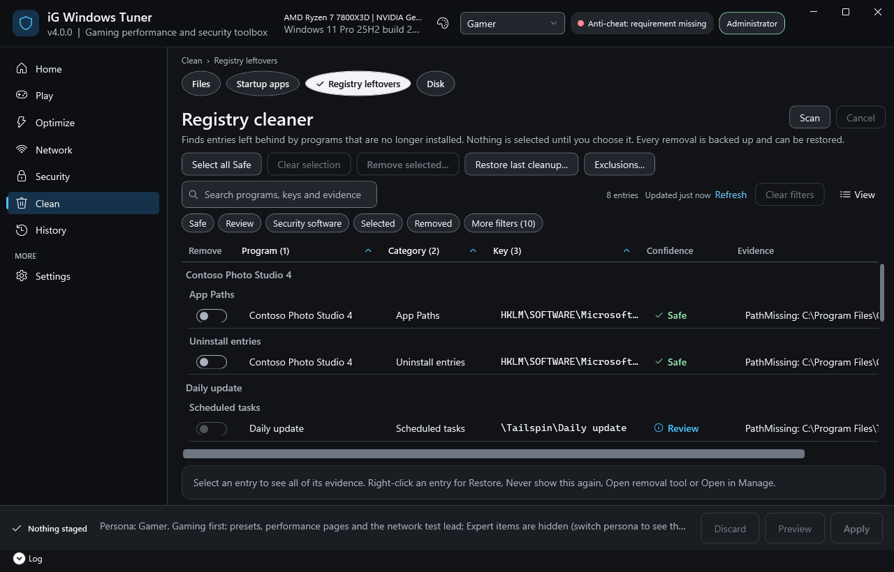
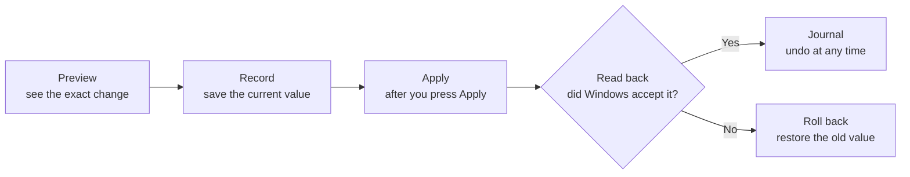

<div align="center">

# 🛡️ iG Windows Tuner

### Tune Windows 11 for gaming, security and privacy.<br>See the evidence. Check every change. Undo anything.

[](https://github.com/arioofarmani/iG-Windows-Tuner/releases/latest)


[](https://github.com/arioofarmani/iG-Windows-Tuner/actions/workflows/ci.yml)

[](LICENSE)

### [⬇️ Download 4.0.0](https://github.com/arioofarmani/iG-Windows-Tuner/releases/latest)

[Start in 3 steps](#-start-in-3-steps) · [What's inside](#-whats-inside) · [Is it safe?](#-is-it-safe) · [FAQ](#-quick-answers) · [Docs](#-documentation)

<table>
<tr>
<td align="center" width="25%"><h3>129</h3>settings, each with its sources</td>
<td align="center" width="25%"><h3>10</h3>presets with a preview first</td>
<td align="center" width="25%"><h3>3 levels</h3>of undo: change, session, everything</td>
<td align="center" width="25%"><h3>0</h3>telemetry, services or scheduled tasks</td>
</tr>
</table>

</div>



## ⚡ In 30 seconds

| | |
|---|---|
| **What it is** | A free, open-source Windows 11 tuner for gamers and power users. |
| **What makes it different** | Every setting shows its sources. Every change is previewed, read back from Windows, and can be undone exactly. |
| **What it won't do** | Promise extra FPS. Placebo, outdated and risky tweaks are [listed as rejected](docs/REJECTED_TWEAKS.md), with the reason. |
| **Is it safe?** | Read-only until you press **Apply**. No telemetry, nothing left running. [Scan results and checks below](#-is-it-safe). |
| **Changed your mind?** | **History → Undo**, for one change, one session or everything iG ever changed. |

## 🚀 Start in 3 steps

> **Needs:** Windows 11 24H2 or newer (build 26100+). Windows PowerShell 5.1 is already part of Windows. Nothing else to install.

1. **Download** `iGWindowsTuner-4.0.0.zip` from [Releases](https://github.com/arioofarmani/iG-Windows-Tuner/releases/latest) and extract it.
2. **Run** `Start-iGWindowsTuner.cmd`. It opens read-only, so look around freely.
3. **Pick** a preset or a single setting, read the preview, press **Apply**. Windows asks for administrator rights when needed.

✅ **Undo:** History → **Undo** on a session, or **Reset everything iG changed**.

<details>
<summary><b>Prefer the command line?</b></summary>

Start with commands that change nothing:

```powershell
.\iGWindowsTuner.ps1 -Report
.\iGWindowsTuner.ps1 -Preset competitive -DryRun
```

Every option: [CLI reference](docs/CLI.md).

</details>

<details>
<summary><b>Windows says the files came from the internet</b></summary>

Files from a downloaded zip carry Mark-of-the-Web. Check the [SHA256](#-is-it-safe), review the files, then run `Unblock-File` on them if you trust them.

</details>

## 🧭 What's inside

Seven sections, one bar at the bottom that applies every change, and Undo for all of it.

| | Section | What you do there |
|---|---|---|
| 🏠 | **Home** | See the one thing that needs you, three status tiles and your recent changes. |
| 🎮 | **Play** | Pick a preset (Competitive, Balanced, Laptop Gamer, Streamer and more), or start Session Mode for match day. |
| ⚡ | **Optimize** | Turn single settings on or off. Each one shows its evidence, anti-cheat status and how it is undone. |
| 🌐 | **Network** | Test latency, jitter and packet loss. See your DNS, network profile and blocked programs. |
| 🔒 | **Security** | Security score, Defender, attack surface rules, firewall and Group Policy. |
| 🧹 | **Clean** | Temporary files, startup apps, registry leftovers and disk usage. |
| 🕘 | **History** | Every change iG made, with Undo. It asks when something else changed a value since. |
| 🛠️ | **Advanced tools** | Expert inspectors, Group Policy, services and tasks, toolkit, Risk Zone. Hidden by default. |

<table>
<tr>
<td width="50%"></td>
<td width="50%"></td>
</tr>
<tr>
<td><b>⚡ Optimize.</b> One list per category, with sources and how to undo each setting.</td>
<td><b>🕘 History.</b> Every change as a card. Undo checks each value before it restores anything.</td>
</tr>
<tr>
<td></td>
<td></td>
</tr>
<tr>
<td><b>🎮 Play.</b> Presets show what they would change on <i>your</i> PC before anything happens.</td>
<td><b>🌐 Network.</b> The network test, DNS (encrypted or not), network profile and blocked programs.</td>
</tr>
<tr>
<td></td>
<td></td>
</tr>
<tr>
<td><b>🔒 Security.</b> Every hardening item with its state, confidence and the exact change.</td>
<td><b>🧹 Clean.</b> Registry leftovers grouped by program, each marked Safe or Review, with a backup.</td>
</tr>
</table>

<sub>Screenshots are offscreen renders with sample data (fictional programs and hardware). Dark, Light and High Contrast themes are included.</sub>

<details>
<summary><b>📋 The full feature list</b></summary>

**🎮 Performance and gaming**
- 10 presets: Competitive, Balanced, Hardened, Laptop Gamer, Streamer & Creator, Privacy Max, Fortress, Engineer Workstation, Clean Install / Debloat and Session Mode
- Power, CPU, graphics, input and network tuning that takes your hardware into account
- Session Mode: temporary changes for match day, all put back at the end
- Network test: latency, jitter, packet loss, stability and a DNS benchmark
- Anti-cheat readiness checks for common kernel anti-cheats

**🔒 Security and privacy**
- Security score with what to fix first
- ASR Center for all 19 attack surface reduction rules, with the gamer impact of each
- Microsoft Defender settings editor: protection settings only move toward on
- Firewall Manager: every rule classified, risk findings, conflicts, an open-ports map and safe fixes
- Firewall log reader, time-boxed forensic logging that restores every setting, and evidence export with SHA256 hashes
- Group Policy browser, security and audit policy, and compliance baselines
- Security settings manager: every security setting with where its value comes from, and a typed confirmation for high-risk changes

**🕘 Safety net**
- Change journal: every change by session, hash-chained so edits are detected
- Undo per change, per session or everything, with a choice whenever a value changed since
- Unfinished changes are found after a crash and can be rolled back
- A read-only check at start finds settings that Windows changed back
- Changes that cannot be undone (removed apps, cleaned files) are recorded and marked as such

**🧹 Maintenance and diagnostics**
- File cleaner with allow-listed rules, and a disk analyzer
- Registry cleaner for leftovers of uninstalled programs, with evidence, backups and restore
- Startup apps: turn on or off, or delete with a backup and Undo
- Services, scheduled tasks, apps and persistence inspector
- Reliability, crashes, boot time, drivers, DPC/ISR and an HTML health report
- App installs through winget, Windows features and previewed repair fixes

</details>

## 🔁 How every change works



- **Before:** you see the exact value now and the value iG would set.
- **During:** the old value is saved first. If Windows refuses the change, iG puts the old value back.
- **After:** the change is in History. Undo restores the saved value, including values that did not exist before.

## ✅ Is it safe?

You should not have to take our word for it. The short version:

- 🔒 **Read-only until you press Apply.** Without administrator rights, the app cannot change anything.
- 📴 **No telemetry.** The network is used only when you ask: the network test, DNS benchmark and winget.
- 🧹 **Nothing left running.** No service, no scheduled task, no Run key.
- 📖 **Readable.** PowerShell and JSON you can open. Small C# helpers ship as plain source and compile on your PC.
- 🧪 **Tested.** 1,757 automated tests, static analysis and a Defender scan on every release, plus [independent code reviews](docs/REVIEW.md).

**Check your download.** The result must match the SHA256 on the [4.0.0 release page](https://github.com/arioofarmani/iG-Windows-Tuner/releases/tag/v4.0.0):

```powershell
Get-FileHash .\iGWindowsTuner-4.0.0.zip -Algorithm SHA256
# 2213AC1D833070108BD2D06D241A7AF7344DB679B6347537F8C37E7487B4D812
```

**Look without any risk.** Read-only mode blocks every change inside the app's engine:

```powershell
.\Start-iGWindowsTuner.cmd -ReadOnly
```

<details>
<summary><b>🦠 VirusTotal results</b></summary>

4.0.0 has not been scanned yet; the results below are for 3.8.1. The launcher is the same file in both (SHA256 `11e4ed3e…6cc66110`).

| File | Result | What it is |
|---|---|---|
| [`iGWindowsTuner-3.8.1.zip`](https://www.virustotal.com/gui/file/7d27fc4ab3a63a1d992f59c513698a8b2c078e9408bab0f7a17951f0f8c4aa9d?nocache=1) | ⚠️ **6 of 65** vendors flagged it | The complete release package |
| [`Start-iGWindowsTuner.cmd`](https://www.virustotal.com/gui/file/11e4ed3e3adc09c146683c668c5fd401ef2ab0c6afea93c7dfd673046cc66110?nocache=1) | ✅ **0 of 60** vendors flagged it | The 721-byte launcher (unchanged since 3.6.5) |

Checked on 14 November 2026. The [3.6.5 main script](https://www.virustotal.com/gui/file/a0ae584f95081ed1340bfafc892579e7bf9be3501cd09af74b632242581413d8?nocache=1) scanned clean (0 of 60). Results can change, so open the links for the current numbers.

**About the 6 flags on the zip.** Arcabit, BitDefender, Emsisoft, GData and VIPRE report the same heuristic, `Heur.BZC.PZQ.Boxter`, and CTX reports `Zip.unknown.boxter`. "Heur" means a rule matched a pattern, not that the file matched known malware. We believe it is a false positive; judge for yourself:

- The zip holds exactly one command script, the launcher above, and it scans clean by itself.
- The launcher starts PowerShell with `-ExecutionPolicy Bypass` for that one process only, because the scripts are not signed. Your execution policies are never changed. [Read all 12 lines](Start-iGWindowsTuner.cmd).
- Antivirus results are not proof either way. If a flag concerns you, read the source or try the app in a virtual machine first.

</details>

<details>
<summary><b>🚫 What the code is not allowed to do</b></summary>

[Automated safety tests](tests/Safety.Tests.ps1) scan the shipped code and fail if they find any of these:

| | |
|---|---|
| 🚫 **Hidden code** | `Invoke-Expression`, Base64-encoded commands or command names built at run time |
| 🚫 **Downloads** | Fetching files or scripts itself (app installs go through winget, only when you ask) |
| 🚫 **Staying behind** | Creating services, scheduled tasks, Run keys or WMI subscriptions |
| 🚫 **Hiding** | Hidden windows, or changing your execution policy |
| 🚫 **Weakening your defenses** | Turning off AMSI, ETW, real-time protection or Tamper Protection, or adding Defender antivirus exclusions |
| 🚫 **Boot and driver tampering** | Running `bcdedit`, turning off driver signature enforcement or enabling test signing |
| 🚫 **UAC tricks** | Anything other than the normal Windows administrator prompt |

</details>

> [!IMPORTANT]
> System tuning can affect stability, security and compatibility. Make a backup before big changes, measure before and after, and check that your games still work. The built-in Undo does not replace a full backup. Provided as-is.

## 💬 Quick answers

<details>
<summary><b>Will it give me more FPS?</b></summary>

Maybe, maybe not. That depends on your PC and games, so iG makes no FPS promise. Settings that need proof say "measure it", and tweaks known to be placebo are [rejected](docs/REJECTED_TWEAKS.md) with the reason.

</details>

<details>
<summary><b>Will it break my anti-cheat?</b></summary>

Every setting carries anti-cheat information. The gaming presets use only items marked safe, and keep Defender, memory integrity and the firewall on. Details: [Anti-cheat compatibility](docs/ANTICHEAT.md).

</details>

<details>
<summary><b>What if Windows Update changes my settings back?</b></summary>

At start, a read-only check finds settings that changed since iG set them, and lists the Windows updates installed in between. You choose: re-apply them, or keep the current values.

</details>

<details>
<summary><b>Can I really undo everything?</b></summary>

Every change is saved before it is made. Undo restores the exact old value, including values that did not exist. A few actions cannot be undone by nature (a removed app, cleaned files); they are marked before you confirm.

</details>

<details>
<summary><b>Does it send anything anywhere?</b></summary>

No. There is no telemetry. The network is used only for what you start yourself: the network test, the DNS benchmark and winget app installs.

</details>

<details>
<summary><b>How does it compare with other tools?</b></summary>

Based only on what each project's own page says (checked November 2026). "Not described" means the page does not mention it; the tool may still offer it.

| | **iG Windows Tuner** | [WinUtil](https://github.com/ChrisTitusTech/winutil) | [Sophia Script](https://github.com/farag2/Sophia-Script-for-Windows) | [O&O ShutUp10++](https://www.oo-software.com/en/shutup10/editions) |
|---|---|---|---|---|
| **Focus** | Gaming, security and privacy tuning with auditing | App installs, tweaks, config, updates | Scripted Windows setup, 150+ functions | Privacy and security, about 300 settings |
| **License** | MIT, open source | MIT, open source | MIT, open source | Freeware, closed source; paid Premium |
| **How it runs** | Download, verify the SHA256, run | One-line remote command | Package manager, download or one-line command | Portable program |
| **Undo** | Per change, per session or everything | Tweaks are expected to ship with an undo | A restore function for every tweak | Restore points, reset per setting, profiles |
| **History of your PC** | Tamper-evident journal | Not described | Not described | Not described |
| **Reads each change back** | Yes, failure rolls back | Not described | Not described | Not described |
| **Sources per setting** | Yes, with a confidence badge | Not described | "Officially documented ways" (overall) | Not described |
| **Anti-cheat information** | Per item; gaming presets use safe items only | Not described | States compatibility with VAC | Not described |

**When another tool fits better:**
- Setting up a fresh PC with your apps? [WinUtil](https://github.com/ChrisTitusTech/winutil) is built around app installs.
- Only privacy settings, fast? [O&O ShutUp10++](https://www.oo-software.com/en/shutup10/editions) is small and portable.
- Automating many PCs from a script? [Sophia Script](https://github.com/farag2/Sophia-Script-for-Windows) is made to be edited and run as a script.
- Not on Windows 11 24H2 or newer? iG Windows Tuner needs build 26100 or later.

</details>

## 🆕 What's new in 4.0

- **A new window:** seven sections instead of 24 pages, and one bar that applies every change.
- **History you can act on:** session cards, Undo with a check of every value, and "Reset everything iG changed".
- **Faster:** no page blocks the window for more than 200 ms after start-up.
- **Safer:** every Medium finding of the independent 3.8.1 review handled.

Earlier releases: [Changelog](docs/CHANGELOG.md).

## 📚 Documentation

| Topic | Read |
|---|---|
| **Getting started** | [User guide](docs/README.md) · [CLI reference](docs/CLI.md) |
| **Settings and presets** | [Tweak catalog and evidence](docs/TWEAKS.md) · [Presets](docs/PRESETS.md) · [Rejected tweaks](docs/REJECTED_TWEAKS.md) · [Hardware](docs/HARDWARE.md) |
| **Security** | [Anti-cheat](docs/ANTICHEAT.md) · [Security principles](docs/SECURITY.md) · [ASR Center](docs/ASR_CENTER.md) · [Security settings](docs/SECURITY_SETTINGS.md) · [Group Policy](docs/GROUP_POLICY.md) |
| **Firewall** | [Firewall Manager](docs/FIREWALL.md) · [Logs and forensics](docs/FIREWALL_LOGS.md) |
| **Cleaning** | [Registry cleaner](docs/REGISTRY_CLEANER.md) |
| **Project** | [Design decisions](docs/DECISIONS.md) · [Independent reviews](docs/REVIEW.md) · [Testing](docs/TESTING.md) · [Changelog](docs/CHANGELOG.md) |

## 🤝 Contributing

Contributions are welcome. A new tweak needs evidence, a clear explanation, risk information, a way back and tests. See [CONTRIBUTING.md](CONTRIBUTING.md).

## 📄 License

[MIT License](LICENSE). Provided as-is, without warranty. Review changes carefully and use the tool at your own risk.

Windows, Microsoft Defender and other product names are trademarks of their owners. This project is not affiliated with Microsoft or with the other tools mentioned.
