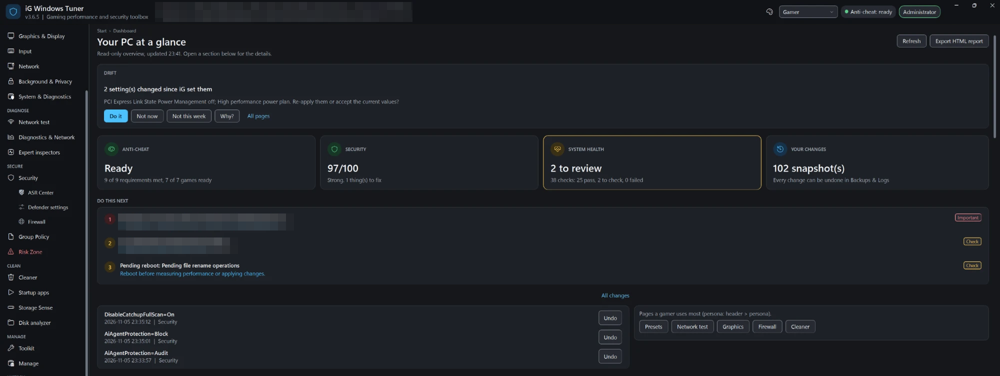
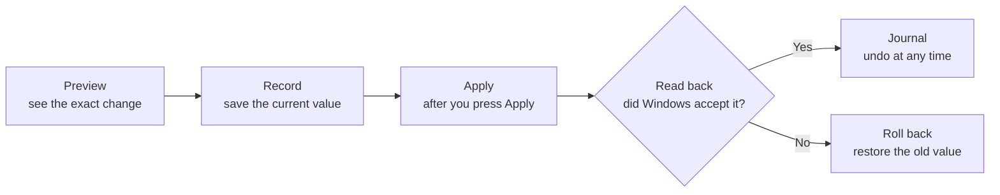
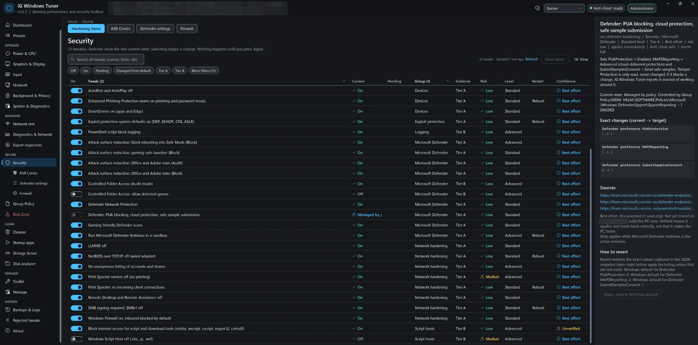
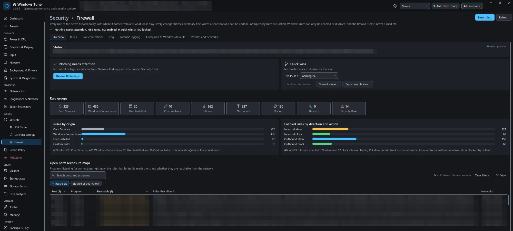
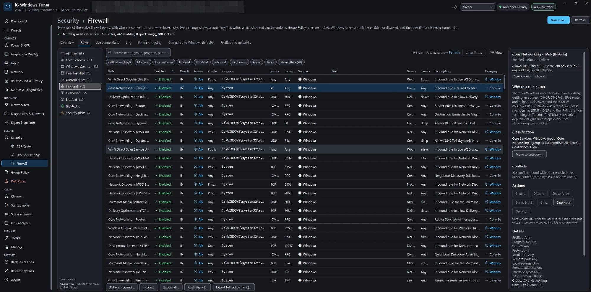
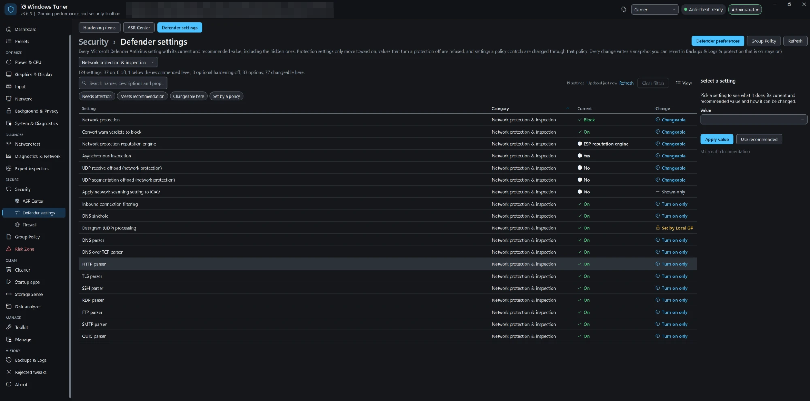
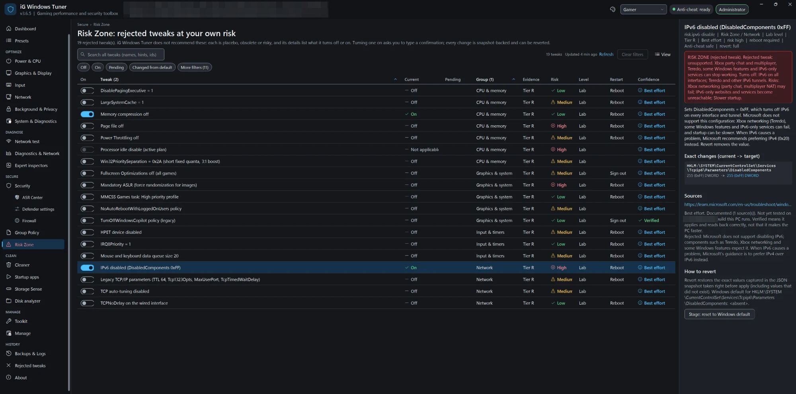

<div align="center">

# iG Windows Tuner

**The Windows 11 tuner that shows its evidence, checks its work and can undo every step.**

Tune performance, security and privacy for competitive gaming, with every change previewed, recorded and reversible.

[](https://github.com/arioofarmani/iG-Windows-Tuner/releases/latest)


[](LICENSE)
[](#is-it-safe-to-run)

[**Download**](https://github.com/arioofarmani/iG-Windows-Tuner/releases/latest) · [Is it safe?](#is-it-safe-to-run) · [Why it's different](#how-it-compares) · [Features](#what-it-does) · [Quick start](#quick-start) · [Docs](#documentation)

<table>
<tr>
<td align="center" width="25%"><h3>129</h3>catalog items, each with its sources</td>
<td align="center" width="25%"><h3>1,076</h3>automated tests</td>
<td align="center" width="25%"><h3>3 levels</h3>of undo: change, session or everything</td>
<td align="center" width="25%"><h3>0</h3>telemetry, services or scheduled tasks</td>
</tr>
</table>

</div>



Most Windows optimizers ask you to trust a list of tweaks. iG Windows Tuner works differently: every setting cites its source, every change is previewed, the result is read back from Windows, and the value from before can be restored exactly, including values that did not exist.

It makes no promise of extra FPS. Tweaks that are placebo, obsolete or risky are documented as [rejected](docs/REJECTED_TWEAKS.md), with the reason.

## Why people use it

| | |
|---|---|
| **Evidence, not folklore** | 129 catalog items, each with its sources and an evidence tier. Every item shows a confidence badge: Verified, Best effort or Unverified. |
| **Every change is a transaction** | The previous value is recorded first, the change is read back, and a failure rolls back automatically. |
| **Undo that is exact** | Revert one change, one session or everything iG ever changed. You see the value before, the value iG set and the value now, and you decide if something else changed it since. |
| **It notices when Windows changes things back** | At start, a read-only check finds settings that drifted and lists the Windows updates installed in between, without claiming they were the cause. |
| **Security stays on** | Gaming presets keep Defender, memory integrity and the firewall on, and use only items marked safe for anti-cheat. |
| **Nothing hidden** | Plain PowerShell and JSON you can read. No telemetry, no background service, no scheduled task, no `irm \| iex` install. |

## How every change works



## See it in action

<table>
<tr>
<td width="50%"></td>
<td width="50%"></td>
</tr>
<tr>
<td><b>Tweaks with their evidence.</b> Current state, tier, risk, confidence, the exact change and how to revert it.</td>
<td><b>Firewall Manager.</b> What needs attention, rule groups and which open ports are really reachable.</td>
</tr>
<tr>
<td></td>
<td></td>
</tr>
<tr>
<td><b>Every rule explained.</b> Why it exists, how it was classified, conflicts and which actions are safe.</td>
<td><b>Defender settings.</b> Every setting with its current value, including the hidden ones. Protection only moves toward on.</td>
</tr>
<tr>
<td></td>
<td valign="top"><b>Risk Zone.</b> Popular tweaks iG does not recommend, separated from everything else. Each one says what it breaks, asks for a typed confirmation and can be reverted.<br><br>Tweaks that turn off security protections, edit boot data or need background software are not offered at all.</td>
</tr>
</table>

Screenshots from a real PC, cropped for size, with hardware, network and open port details blurred for privacy. Dark, Light and High Contrast themes are included.

## How it compares

iG Windows Tuner is built for people who want to know exactly what changed and get it back. The table covers well-known free tools, based only on what each project's own page says (checked November 2026). "Not described" means the page does not mention it; the tool may still offer it, so check the project if it matters to you.

| | **iG Windows Tuner** | [WinUtil](https://github.com/ChrisTitusTech/winutil) | [Sophia Script](https://github.com/farag2/Sophia-Script-for-Windows) | [O&O ShutUp10++](https://www.oo-software.com/en/shutup10/editions) |
|---|---|---|---|---|
| **Focus** | Gaming, security and privacy tuning with auditing | App installs, tweaks, config, updates | Scripted Windows setup, 150+ functions | Privacy and security, about 300 settings |
| **License** | MIT, open source | MIT, open source | MIT, open source | Freeware, closed source; paid Premium |
| **How it runs** | Download, verify the SHA256, run | One-line remote command | Package manager, download or one-line command | Portable program |
| **Undo** | Per change, per session or everything | Tweaks are expected to ship with an undo (contributor rules) | A restore function for every tweak | Restore points, undo recommended settings, reset per setting, profiles |
| **Before/after history of your PC** | Tamper-evident journal | Not described | Not described | Not described |
| **Reads each change back** | Yes, failure rolls back | Not described | Not described | Not described |
| **Sources shown per setting** | Yes, with a confidence badge | Not described | Uses "officially documented ways" (overall) | Not described |
| **Detects changed settings** | Free, you choose to re-apply or accept | Not described | Not described | Premium: restores automatically after updates |
| **Anti-cheat information** | Per item; gaming presets use safe items only | Not described | States compatibility with VAC | Not described |
| **Firewall rule manager** | Yes, with risk findings | Not described | Not described | Not described |
| **Group Policy browser and editor** | Yes | Not described | Shows its policies in gpedit | Not described |

### When another tool is the better choice

iG Windows Tuner is not the right tool for everything, and these are good projects:

- **Setting up a fresh PC with your apps?** [WinUtil](https://github.com/ChrisTitusTech/winutil) is built around installing apps alongside tweaks.
- **Only want privacy settings, fast?** [O&O ShutUp10++](https://www.oo-software.com/en/shutup10/editions) is a small portable program covering about 300 of them.
- **Automating many PCs from a script?** [Sophia Script](https://github.com/farag2/Sophia-Script-for-Windows) is designed to be edited and run as a script.
- **Not on Windows 11 24H2 or newer?** iG Windows Tuner needs build 26100 or later.

## What it does

**Performance and gaming**
- 10 presets, including Competitive, Balanced, Laptop Gamer and Streamer, each with a preview of what it would change on your PC
- Power, CPU, graphics, input and network tuning that takes your hardware into account
- Session Mode for temporary changes while you play
- Network test: latency, jitter, packet loss and stability
- Anti-cheat readiness checks for common kernel anti-cheats

**Security and privacy**
- Security score with what to fix first
- ASR Center for all 19 attack surface reduction rules, with the gamer impact of each
- Editor for Microsoft Defender settings: protection settings only move toward on
- Firewall Manager: every rule classified, risk findings, conflict analysis, an open ports map and safe fixes
- Firewall log reader, time-boxed forensic logging that restores every setting, and evidence export with SHA256 hashes
- Group Policy browser, security and audit policy, and compliance baselines

**Safety net**
- Change journal: every change by session, hash-chained so edits are detected
- Revert per change, per session or everything, with a choice whenever a value changed since
- Unfinished changes are found after a crash and can be rolled back
- Update drift guardian and a home card showing the one thing that needs attention
- Changes that cannot be undone (removed apps, cleaned files) are recorded and marked as such

**Maintenance and diagnostics**
- Cleaner with allow-listed rules, disk analyzer and startup apps
- Services, scheduled tasks, apps and persistence inspector
- Reliability, crashes, boot time, drivers, DPC/ISR, and an HTML health report
- App installs through winget, Windows features and previewed repair fixes

## Quick start

**Requirements:** Windows 11 24H2 or newer (build 26100+). Windows PowerShell 5.1 is included with Windows; nothing else to install.

1. Download `iGWindowsTuner-3.6.5.zip` from [Releases](https://github.com/arioofarmani/iG-Windows-Tuner/releases/latest) and [check its SHA256](#check-it-yourself).
2. Extract it. Files from a downloaded zip carry Mark-of-the-Web: review them, then run `Unblock-File` if you trust them.
3. Run `Start-iGWindowsTuner.cmd`.
4. Look around first. Without administrator rights the app is read-only, and nothing changes until you press **Apply**.
5. Pick a preset or a single setting, read the preview and apply. Windows asks for administrator rights when needed.

**To undo:** Backups & Logs > Change journal, then revert a change, a session or everything.

Prefer the command line? Start with what changes nothing:

```powershell
.\iGWindowsTuner.ps1 -Report
.\iGWindowsTuner.ps1 -Preset competitive -DryRun
```

## Is it safe to run?

You should not have to take our word for it, so here is what the scanners say, including the part that is less tidy, and how to check the app yourself.

### VirusTotal results for 3.6.5

| File | Result | What it is |
|---|---|---|
| [`iGWindowsTuner.ps1`](https://www.virustotal.com/gui/file/a0ae584f95081ed1340bfafc892579e7bf9be3501cd09af74b632242581413d8?nocache=1) | ✅ **0 of 60** vendors flagged it | The main script |
| [`Start-iGWindowsTuner.cmd`](https://www.virustotal.com/gui/file/11e4ed3e3adc09c146683c668c5fd401ef2ab0c6afea93c7dfd673046cc66110?nocache=1) | ✅ **0 of 60** vendors flagged it | The 721-byte launcher |
| [`iGWindowsTuner-3.6.5.zip`](https://www.virustotal.com/gui/file/3ff339c805e8b8f61de5792111e8611d2042ecd60039b0f76eb3b6edb9d40f7e) | ⚠️ **6 of 66** vendors flagged it | The complete release package |

Results checked on 6 November 2026. They can change, so open the links for the current numbers.

**About the 6 flags on the zip.** Arcabit, BitDefender, Emsisoft, GData and VIPRE report the same heuristic name, `CMD:Heur.BZC.PZQ.Boxter`, and CTX reports `Zip.unknown.boxter`. "Heur" means a rule matched a pattern, not that the file matched known malware. We believe this is a false positive, but you can judge for yourself:

- The zip holds exactly one command script, the launcher above, and it scans clean by itself.
- That launcher starts PowerShell with `-ExecutionPolicy Bypass`, for that one process only, because the scripts are not signed. Your machine and user execution policies are never changed. [Read all 12 lines](Start-iGWindowsTuner.cmd).
- Antivirus results are not proof either way, and the two clean results above cover only those two files. If a flag concerns you, read the source or try the app in a virtual machine first.

### Check it yourself

**Confirm your download is the published file.** The result must be `3FF339C805E8B8F61DE5792111E8611D2042ECD60039B0F76EB3B6EDB9D40F7E`:

```powershell
Get-FileHash .\iGWindowsTuner-3.6.5.zip -Algorithm SHA256
```

**Look without changing anything.** Read-only mode blocks every change inside the app's engine:

```powershell
.\Start-iGWindowsTuner.cmd -ReadOnly
```

**Read the code.** Everything that runs is here on GitHub, in [`src`](src) and [`data`](data).

### What the code is not allowed to do

[Automated safety tests](tests/Safety.Tests.ps1) scan the shipped code for these techniques and fail if they find one:

| | |
|---|---|
| 🚫 **Hidden code** | `Invoke-Expression`, Base64-encoded commands or command names built at run time |
| 🚫 **Downloads** | Fetching files or scripts itself (app installs go through winget, only when you ask) |
| 🚫 **Staying behind** | Creating services, scheduled tasks, Run keys or WMI subscriptions |
| 🚫 **Hiding** | Hidden windows, or changing your machine or user execution policy |
| 🚫 **Weakening your defenses** | Turning off AMSI, ETW, real-time protection or Tamper Protection, or adding Defender antivirus exclusions |
| 🚫 **Boot and driver tampering** | Running `bcdedit`, turning off driver signature enforcement or enabling test signing |
| 🚫 **UAC tricks** | Anything other than the normal Windows administrator prompt |

### Trust and transparency

- **No telemetry.** The network is used only when you ask: the network test, DNS benchmark and winget.
- **No persistence.** No service and no scheduled task. Checks run while the app is open.
- **Readable.** PowerShell and JSON, plus small C# helpers in plain source, compiled on your PC. Nothing is downloaded or decoded at run time.
- **Tested.** 1,076 automated tests, static analysis and a Defender scan on every release, plus independent code reviews published in [docs/REVIEW.md](docs/REVIEW.md).

> [!IMPORTANT]
> System tuning can affect stability, security and compatibility. Create a backup before significant changes, measure before and after, and check that your games still work. The built-in undo is not a replacement for a complete backup. This project is a preview, provided as-is.

## Documentation

- [User guide](docs/README.md)
- [Tweak catalog and evidence](docs/TWEAKS.md) · [Presets](docs/PRESETS.md) · [Rejected tweaks and why](docs/REJECTED_TWEAKS.md)
- [Anti-cheat compatibility](docs/ANTICHEAT.md) · [Security and design principles](docs/SECURITY.md)
- [Firewall Manager](docs/FIREWALL.md) · [Firewall logs and forensics](docs/FIREWALL_LOGS.md)
- [Design decisions](docs/DECISIONS.md) · [Independent reviews](docs/REVIEW.md) · [Testing](docs/TESTING.md) · [Changelog](docs/CHANGELOG.md)

## Contributing

Contributions are welcome. A new tweak needs supporting evidence, a clear explanation, risk information, a way back and tests. See [CONTRIBUTING.md](CONTRIBUTING.md).

## License

Released under the [MIT License](LICENSE). Provided as-is, without warranty. Review changes carefully and use the tool at your own risk.

Windows, Microsoft Defender and other product names are trademarks of their owners. This project is not affiliated with Microsoft or with the other tools mentioned.
