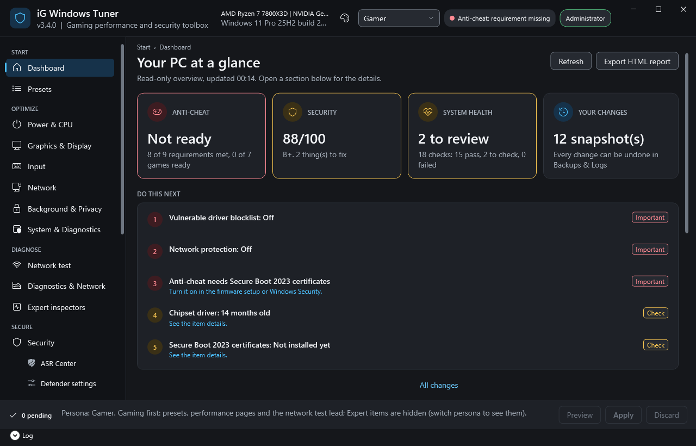
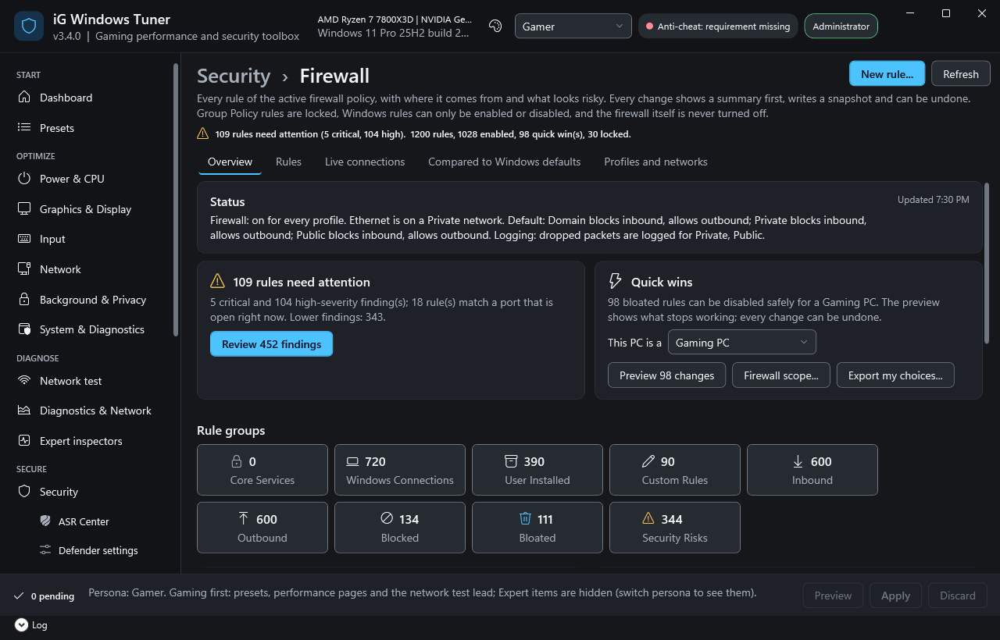
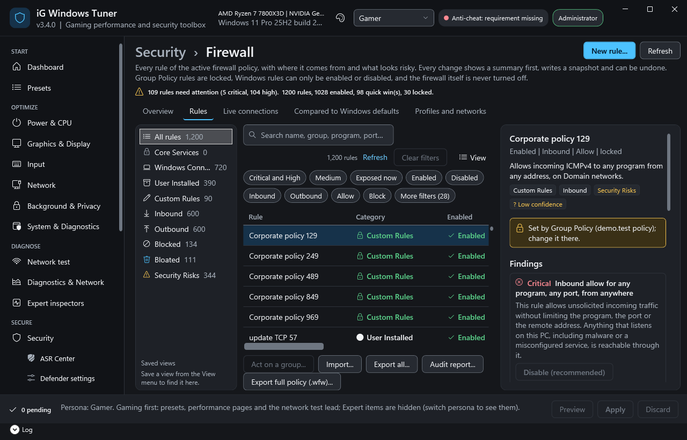
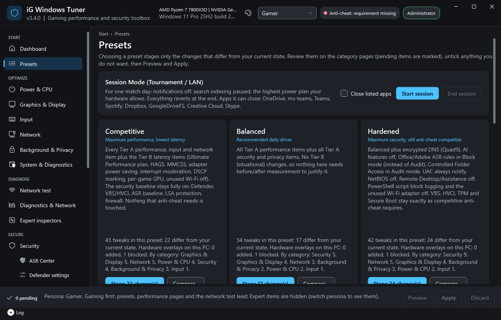

# iG Windows Tuner

**An auditable, reversible Windows 11 tuner for competitive gaming that keeps your PC secure and your anti-cheat happy.**

**Evidence-based Windows 11 tuning. Transparent changes. Reversible by design.**

iG Windows Tuner is an open-source Windows 11 utility for managing system performance, security, privacy, gaming settings, and advanced Windows configuration.

Built with PowerShell and WPF, it combines curated presets with detailed system controls, security auditing, diagnostics, and configuration management.

Unlike one-click optimization tools, iG Windows Tuner shows what a change does, why it exists, and how to undo it.

## Why iG Windows Tuner?

- **Evidence-based tuning** — Settings are documented with Microsoft or hardware-vendor sources, or clearly identified as requiring measurement.
- **Reversible changes** — Previous configuration values are captured before supported changes are applied, with individual and bulk rollback options.
- **Security-focused** — Security controls are designed to strengthen or preserve protection rather than sacrifice it for speculative performance gains.
- **Gaming-aware** — Includes competitive gaming presets and checks for important kernel anti-cheat prerequisites.
- **Full transparency** — Review current and proposed values before applying changes.
- **Built-in diagnostics** — Inspect system health, security configuration, network performance, and Windows reliability.
- **No forced changes on launch** — The graphical interface starts in read-only mode.

## Screenshots

| | |
|---|---|
|  |  |
| Dashboard: status at a glance, one numbered "Do this next" list | Firewall Manager: what needs attention, quick wins, rule groups |
|  |  |
| Every rule explained: origin, confidence, findings and safe fixes | Presets with changes per category and a compare view |

Screenshots are rendered offscreen from demo data (`tools\Test-GuiRender.ps1`); more in [docs/screenshots/3.4](docs/screenshots/3.4), and the 3.0 interface for comparison in [docs/screenshots/3.3/before](docs/screenshots/3.3/before).

## What can you do?

### Performance and gaming

Explore CPU, power, graphics, input, and network settings. Compare measured results instead of assuming every tweak improves performance.

### Security and privacy

Audit Windows security settings, review Microsoft Defender configuration, manage privacy policies, and inspect potential security weaknesses.

### Firewall Manager (new in 3.4)

Every firewall rule is classified (Core Services, Windows Connections, User Installed, Custom Rules) with the reason and a confidence level. Risk findings come with plain explanations and safe fixes, alongside conflict analysis, an exposure map of open ports, a smart fix wizard, firewall scopes per kind of PC and an audit report. Core Services stay read-only, Windows rules are never deleted, game and anti-cheat rules are never blocked, and every change is previewed, snapshot-backed and undoable. See [docs/FIREWALL.md](docs/FIREWALL.md).

### Firewall logs and forensics (new in 3.5)

Read the Windows Firewall log in a fast, filterable list with an overview of what was blocked and allowed (a full 32 MB log loads in about 2 seconds). Turn on forensic logging for a limited time (the firewall log, connection auditing with program names, and the DNS client log) and every setting is restored exactly afterwards. Collect an evidence package with SHA256 hashes and a chain-of-custody file, or export the data for analysis with internal addresses and user names pseudonymized. Nothing is uploaded and no log is ever cleared. See [docs/FIREWALL_LOGS.md](docs/FIREWALL_LOGS.md).

### Transactions and undo (new in 3.6)

Every change is recorded before it is made, read back after it, and rolled back automatically if part of it fails. Backups & Logs > Change journal shows every change by session; revert one change, one session or everything iG changed, with the value before, the value iG set and the value now. The Dashboard's home card shows the one thing that needs attention (an unfinished change, settings Windows changed back, Unverified items), every tweak has a confidence badge, and presets show a preview of what they would change on this PC. See [docs/CHANGELOG.md](docs/CHANGELOG.md).

### Presets and configuration

Choose from curated profiles for different workloads, create custom presets, and review configuration changes before applying them.

### Diagnostics and system management

Generate system health reports, inspect services and scheduled tasks, review firewall rules, troubleshoot Windows, and examine network latency and reliability.

### Advanced Windows administration

Explore Group Policy, security policies, Defender controls, compliance baselines, and configuration exports.

### Interface

Dark, Light and High Contrast themes, grouped navigation, sortable and filterable lists everywhere, focus mode, a read-only mode for audits, and a calm, predictable layout ([docs/UX_GUIDELINES.md](docs/UX_GUIDELINES.md)).

## Quick start

### Requirements

- Windows 11 Pro 24H2 or newer (build 26100+).
- Windows PowerShell 5.1, included with Windows. PowerShell 7.4 is also supported.
- No additional dependencies are required.

### Run the application

1. Download or clone this repository.
2. Run `Start-iGWindowsTuner.cmd`.
3. Review the interface and inspect your current settings.
4. Choose a preset or individual setting.
5. Review the proposed changes before applying them.

The graphical interface starts in read-only mode. Administrator privileges are requested through Windows UAC when needed to apply changes.

## Before applying changes

System tuning can affect stability, security, and application compatibility.

- Review each proposed change before approving it.
- Start with read-only reports and `-DryRun` commands.
- Create a backup and a Windows restore point before significant changes.
- Measure performance before and after tuning.
- Verify that your games, applications, and security requirements still work as expected.

The built-in snapshots and rollback features help restore supported configuration changes, but they are not a substitute for a complete backup.

## Project status

**Version 3.6 — Preview**

3.6 makes every change a recorded, checked and reversible transaction: a tamper-evident change journal, exact undo per change, session or everything, confidence badges, previewed declarative presets, an update drift guardian and a home card. It builds on 3.5 (firewall logs and forensics) and 3.4 (the 3.3 quality release with a rebuilt, calmer interface, plus the Firewall Manager). The Group Policy, security auditing, Defender management and gaming network optimization features are available in the graphical interface and on the command line. See the [changelog](docs/CHANGELOG.md).

Some features and workflows are still evolving. Review the documentation before relying on the tool for production or security-critical systems.

## Documentation

- [User guide](docs/README.md)
- [Tweak catalog and evidence](docs/TWEAKS.md)
- [Preset guide](docs/PRESETS.md)
- [Anti-cheat compatibility](docs/ANTICHEAT.md)
- [Firewall Manager guide](docs/FIREWALL.md) and [how rules are classified](docs/FIREWALL_CATEGORIES.md)
- [Firewall logs, forensic logging and evidence export](docs/FIREWALL_LOGS.md)
- [Security and design principles](docs/SECURITY.md)
- [Design decisions](docs/DECISIONS.md)
- [Rejected tweaks and their rationale](docs/REJECTED_TWEAKS.md)
- [Testing methodology](docs/TESTING.md)
- [Changelog](docs/CHANGELOG.md)

## Contributing

Contributions are welcome. New tweaks should include supporting evidence, a clear explanation, risk information, a rollback path, and appropriate tests.

See [CONTRIBUTING.md](CONTRIBUTING.md) to get started.

## License

Released under the [MIT License](LICENSE).

Provided as-is, without warranty. Review changes carefully and use the tool at your own risk.
