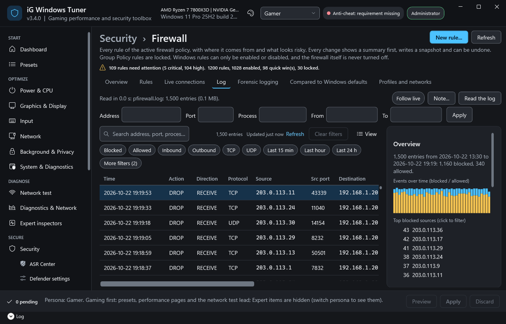
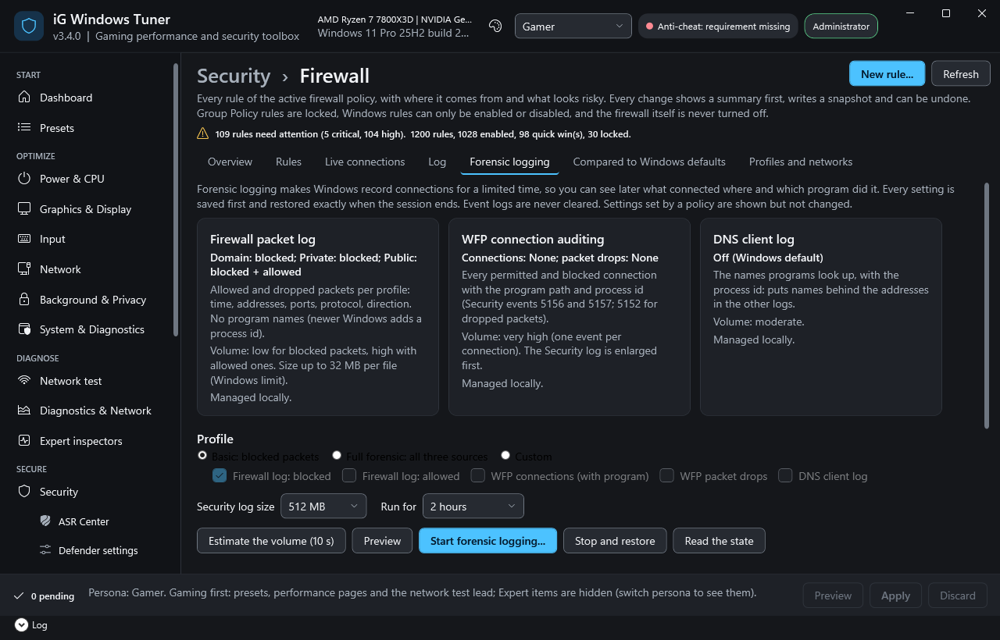

# Firewall logs and forensic logging

iG Windows Tuner 3.5 can read the Windows Firewall log, make Windows record connections for a limited time, and collect what was recorded as evidence or as an export for analysis (for example by an AI assistant). Everything here reads; the only changes are the forensic logging settings, which are saved first and restored exactly.

Where: **Security > Firewall**, tabs **Log** and **Forensic logging**. Sources and verification: [DECISIONS.md](DECISIONS.md) F10 to F13.

## The firewall log (Log tab)



Windows writes the firewall log (`%windir%\system32\LogFiles\Firewall\pfirewall.log` by default) when logging is on for a profile (Profiles and networks tab, "Log blocked connections"). It is at most 32 MB (32,767 KB); when it is full, Windows removes old entries.

1. Press **Read the log**. The newest entries show at once; the whole log (and an older `pfirewall.log.old`, when there is one) follows in the background. Reading the default log needs administrator rights.
2. Narrow it down with the quick filters (Blocked, Allowed, Inbound, Outbound, TCP, UDP, ICMP, last 15 minutes, hour or 24 hours), the search box, and the filter row: an address or a network (`192.168.1.0/24`, `2001:db8::/32`), ports (`80, 443`), a process name or id, and a time range (`yyyy-MM-dd HH:mm`). Save a view to keep a filter.
3. The **Overview** on the right sums up the current view: counts, events over time, and the top blocked sources, blocked ports (with what the port is usually for), processes and remote addresses. Click one to filter on it.
4. **Rules for the selected port** opens the Rules tab searching for that port. **Note...** bookmarks entries with your own text; notes stay on this PC and are included in exports. **Follow live** shows new entries every 2 seconds.

What the messages mean:

| Message | What to do |
|---|---|
| Needs administrator rights | Use "Restart as administrator" and read again. |
| Logging is off for the ... profile | Turn on "Log blocked connections" for it (Profiles and networks tab). |
| The log file does not exist yet | Windows writes it after logging is on and a packet was logged. Use the PC for a while. |
| The log folder does not exist | A custom folder must exist and the Windows Defender Firewall service (`NT SERVICE\mpssvc`) must be able to write to it; or use the default path. |
| Lines skipped | Lines that do not match the log's own `#Fields:` header, or a last line Windows is still writing. They are counted, not hidden. |

What the firewall log can and cannot tell you: time, allowed or dropped, protocol, addresses, ports, size, TCP flags and the direction as Windows writes it (`SEND` outbound, `RECEIVE` inbound). It has **no program names**; newer Windows versions add a process id, and the name shown is the process that has that id now (best effort: ids are reused).

## Forensic logging (Forensic logging tab)



Three sources, each shown with what it records, its volume, its state and whether a policy manages it:

| Source | Records | Volume |
|---|---|---|
| Firewall packet log | Allowed and dropped packets per profile; no program names | Low (blocked only) to high (with allowed) |
| WFP connection auditing | Every permitted and blocked connection with the program path and process id (Security events 5156, 5157; 5152 for dropped packets) | Very high: about one event per connection |
| DNS client log | The names programs look up, with the process id (puts names behind addresses) | Moderate |

Profiles: **Basic** (blocked packets in every profile), **Full forensic** (all three sources, allowed and blocked; WFP packet drops included), **Custom**. **Preview** lists every setting with its current and new value; **Start forensic logging...** shows the preview again, saves every setting, and starts.

- Sessions run 30 minutes, 2 hours, 8 hours or until you stop them. A banner shows "Forensic logging active since ...". When the time is up and iG Windows Tuner is open, the previous settings come back automatically. If it was closed, the next start shows the session as ended and offers **Stop and restore**. No scheduled task or service is created.
- Before anything changes, the firewall profile logging settings, the two audit subcategories (with `auditpol /backup`), the Security log size and the DNS client log state are saved; **Stop and restore** puts them back exactly. If starting fails halfway, everything already changed is restored.
- The Security log is enlarged before auditing starts (256 MB, 512 MB or 1 GB; a larger current size is kept). Event logs are never cleared: collected events stay.
- Settings set by a policy (Group Policy, a domain or MDM) are shown and not changed. Logs are never written to a network share.
- **Estimate the volume** watches new connections for 10 seconds and shows the expected events per hour and how many hours each Security log size holds. The bytes per event are an assumption (about 1 KB); the real number shows after a session.
- Gaming: start a time-boxed session when you want to look into something, not during competitive play. Packet drop auditing is meant for troubleshooting only (Microsoft's guidance).

A typical forensic workflow: start **Full forensic** for 2 hours, use the PC as usual (or reproduce what worries you), let the session end, then collect evidence or export for analysis with the same time range.

## Evidence package

**Collect evidence package...** creates `igwt-evidence-<date-time>` in a local folder you choose (and optionally a zip with its SHA256):

- `firewall\` copies of the firewall logs (originals are opened read-only and shared, never moved or changed), the firewall policy (`.wfw`) and `settings.json` (profiles and logging settings);
- `events\` `.evtx` exports of the WFP events (5152, 5156, 5157) and the DNS client events of the time range;
- `system\` listening ports and running processes at collection time;
- `notes.json`, `manifest.json` (tool version, UTC and local time, range, sources with their status, the SHA256 of every file) and `chain-of-custody.txt` (who collected, when, how, and the hashes).

## Export for AI analysis

**Export for AI analysis...** writes `igwt-forensic-export-<date-time>`:

- `events-0001.jsonl` (or `.csv`), about 5 MB per file: one schema for the firewall log, WFP and DNS events (`SCHEMA.md` explains every field);
- `flows.jsonl` (or `.csv`): events per program, remote address, port and protocol, with first and last time seen, counts and bytes;
- `ANALYSIS_BRIEF.md`: the range, sources, known gaps, the redaction used, and the warning that every value is untrusted network data that may try to manipulate an AI.

By default internal addresses, local host names, user names and user folders are replaced by consistent pseudonyms (`ip-...`, `host-...`, `user-...`; a keyed hash whose key is never stored, so the same value has the same pseudonym within one export only). **Raw** keeps the real values: use it only on this PC. Exports contain sensitive data; iG Windows Tuner never uploads anything.

## Command line and PowerShell

```powershell
Import-Module .\src\iGWindowsTuner.psd1
Get-IgwtFirewallLogReport                       # text summary (also: iGWindowsTuner.ps1 -FirewallLog)
$s = Read-IgwtFirewallLogSession                # all entries, with files and messages
Get-IgwtForensicLoggingState
Get-IgwtForensicLoggingPlan -LoggingProfile Full -SecurityLogMB 512   # preview only
Export-IgwtEvidencePackage -Destination D:\Evidence -From (Get-Date).AddHours(-2) -Zip
Export-IgwtForensicDataset -Destination D:\Exports -From (Get-Date).AddHours(-2) -Format JSONL
```
